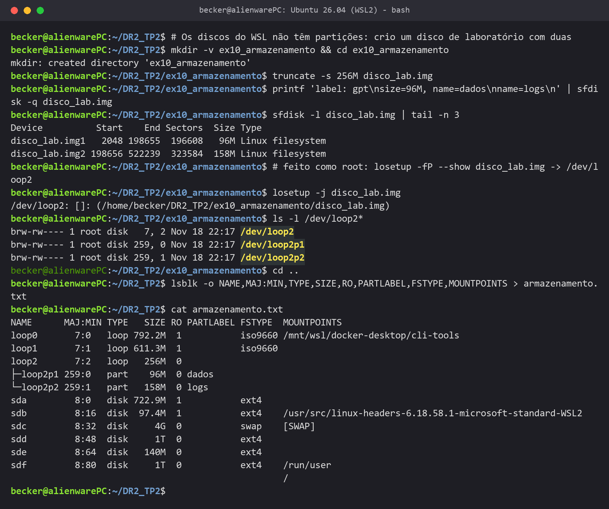

<div align="center">


# 🐧 O Linux e o Hardware pela Linha de Comando

**Shell expansions, pipelines, redirecionamento e aspas; dispositivos, drivers, sysfs, udev, logs do kernel, discos e filesystems no bash do Ubuntu**

<sub>DR2-TP2 · Bloco Ciência da Computação · Trabalho individual</sub>

<br/>

[](docs/RELATORIO_TP2.md)
[](evidencias/DR2_TP2)

<br/>

[](#ambiente)
[](#ambiente)
[](#ambiente)
[](#como-reproduzir)
[](LICENSE)
[](#estado)

<br/>



<sub>Disco de laboratório com duas partições GPT na hierarquia do <code>lsblk</code> (Exercício 10).</sub>

</div>

---

<a id="indice"></a>

## 📚 Índice

| | O trabalho | | Qualidade e entrega |
|:---:|---|:---:|---|
| 01 | [Visão geral](#visao-geral) | 05 | [Atendimento à rubrica](#atendimento) |
| 02 | [Os 12 exercícios](#exercicios) | 06 | [Estrutura do projeto](#estrutura) |
| 03 | [Ambiente](#ambiente) | 07 | [Estado do projeto](#estado) |
| 04 | [Como reproduzir](#como-reproduzir) | 08 | [Referências](#referencias) |
| | | 09 | [Licença](#licenca) |

---

<a id="visao-geral"></a>

## 💡 Visão geral

Teste de Performance com 12 exercícios sobre a operação do Linux pela linha de comando e sobre como
o Linux expõe o hardware. Fiz todos no terminal do Ubuntu, no WSL2, e cada exercício gera o arquivo
de evidência (`.txt`) pedido pelo enunciado:

- **o shell:** expansões, pipelines, redirecionamento de entrada, saída e erro, `/dev/null` e aspas;
- **o kernel e os dispositivos:** `/dev`, sysfs, metadados do udev, mensagens do kernel no journal e drivers em `/proc/devices`;
- **o armazenamento:** discos e partições com `lsblk`, filesystems com `mount`, `findmnt` e `df`;
- **a análise integrada:** um mesmo disco visto por `/dev`, pelo kernel e pela hierarquia de block devices, com cada etapa registrada e consolidada em `analise_final.txt`.

Os prints foram copiados do próprio terminal no momento em que cada comando terminou, sem recorte
nem edição, inclusive as telas do `less`, do `man` e do `journalctl`.

<p align="right"><a href="#indice">⬆ voltar ao índice</a></p>

---

<a id="exercicios"></a>

## 🧭 Os 12 exercícios

| Ex. | Tema | Comandos principais | Evidência | Detalhes |
|:---:|---|---|---|:---:|
| 1 | Shell expansions | `{a,b}`, `{01..03}`, `*`, `?`, `[ ]`, `$( )` | [expansoes.txt](evidencias/DR2_TP2/expansoes.txt) | [ver](docs/RELATORIO_TP2.md#exercicio-1) |
| 2 | Pipeline e redirecionamento | `\|`, `less`, `>`, `<`, `wc` | [pipeline.txt](evidencias/DR2_TP2/pipeline.txt) | [ver](docs/RELATORIO_TP2.md#exercicio-2) |
| 3 | Pipelines em `/dev` | `grep '^b'`, `cut`, `sort`, `uniq -c` | [dispositivos_bloco.txt](evidencias/DR2_TP2/dispositivos_bloco.txt) | [ver](docs/RELATORIO_TP2.md#exercicio-3) |
| 4 | `/dev/null` | `>`, `2>`, `2>&1`, `$?` | [redirecionamento.txt](evidencias/DR2_TP2/redirecionamento.txt) | [ver](docs/RELATORIO_TP2.md#exercicio-4) |
| 5 | Aspas | `' '`, `" "`, `\` | [aspas.txt](evidencias/DR2_TP2/aspas.txt) | [ver](docs/RELATORIO_TP2.md#exercicio-5) |
| 6 | sysfs | `/sys/block`, `cat`, `grep .`, `pwd -P` | [sysfs.txt](evidencias/DR2_TP2/sysfs.txt) | [ver](docs/RELATORIO_TP2.md#exercicio-6) |
| 7 | udev | `udevadm info`, `--attribute-walk`, `>>` | [udev_info.txt](evidencias/DR2_TP2/udev_info.txt) | [ver](docs/RELATORIO_TP2.md#exercicio-7) |
| 8 | Logs do kernel | `journalctl -k`, `grep -iE` | [kernel_devices.txt](evidencias/DR2_TP2/kernel_devices.txt) | [ver](docs/RELATORIO_TP2.md#exercicio-8) |
| 9 | Drivers | `/proc/devices`, `sed`, `grep` | [drivers.txt](evidencias/DR2_TP2/drivers.txt) | [ver](docs/RELATORIO_TP2.md#exercicio-9) |
| 10 | Discos e partições | `lsblk -o`, `sfdisk`, `losetup` | [armazenamento.txt](evidencias/DR2_TP2/armazenamento.txt) | [ver](docs/RELATORIO_TP2.md#exercicio-10) |
| 11 | Filesystems | `mount`, `findmnt`, `df -hT`, `df -i` | [filesystems.txt](evidencias/DR2_TP2/filesystems.txt) | [ver](docs/RELATORIO_TP2.md#exercicio-11) |
| 12 | Análise integrada | `findmnt`, `/proc/partitions`, `journalctl`, `lsblk`, `whatis`, `man` | [analise_final.txt](evidencias/DR2_TP2/analise_final.txt) | [ver](docs/RELATORIO_TP2.md#exercicio-12) |

Cada exercício no [relatório técnico](docs/RELATORIO_TP2.md) traz o enunciado, a teoria, os prints
do terminal e a minha resposta.

<p align="right"><a href="#indice">⬆ voltar ao índice</a></p>

---

<a id="ambiente"></a>

## 🖥️ Ambiente

| Item | Configuração |
|---|---|
| Sistema hospedeiro | Windows 11 Pro, SSD NVMe de 1 TB |
| Linux | Ubuntu 26.04.1 LTS no WSL2 |
| Kernel | 6.18.58.1-microsoft-standard-WSL2, x86_64 |
| Shell | GNU bash 5.3.9 |
| Discos do WSL | seis discos virtuais SCSI (`Msft Virtual Disk`, driver `hv_storvsc`), sem partições; a raiz é o `/dev/sdf`, ext4 de 1 TB |
| Diretório de trabalho | `~/DR2_TP2`, copiado em [evidencias/DR2_TP2](evidencias/DR2_TP2) |

<p align="right"><a href="#indice">⬆ voltar ao índice</a></p>

---

<a id="como-reproduzir"></a>

## ▶️ Como reproduzir

Os exercícios rodam num bash dentro de um tmux com configuração própria, isolada do `~/.tmux.conf`.
Cada comando é digitado no terminal e executado de verdade, e cada tela é extraída do buffer do
terminal (`tmux capture-pane`).

```bash
wsl -d Ubuntu --exec bash scripts/capturar_telas.sh
```

O roteiro recomeça do zero (apaga `~/DR2_TP2`) e descobre sozinho o disco da raiz, cuja letra
(`sdX`) muda de máquina para máquina. No Exercício 10 ele cria `disco_lab.img` (256 MiB, esparso)
e, como root pelo próprio WSL, o associa a um loop device; ao final, desfaz a associação. Nenhum
disco real é alterado.

Para converter as telas em PNG:

```bash
uv run --no-project --with pillow python scripts/renderizar_telas.py
```

O documento de entrega é montado sobre o molde institucional e exportado pelo Word:

```bash
python scripts/gerar-documento.py
```

```bash
powershell -ExecutionPolicy Bypass -File scripts/exportar-pdf.ps1
```

<p align="right"><a href="#indice">⬆ voltar ao índice</a></p>

---

<a id="atendimento"></a>

## 🎯 Atendimento à rubrica

| Critério | Onde está |
|---|---|
| Utiliza shell expansions de forma correta e eficiente | Ex. 1 (chaves para criar, curingas para listar) e as expansões dos Ex. 6, 10 e 12 |
| Cria pipelines e redireciona entrada e saída | Ex. 2 (`\|`, `>`, `<`), 3, 4 (`2>`, `2>&1`), 7 e 9 (`>>`), 8, 11 e 12 |
| Utiliza corretamente aspas simples e duplas | Ex. 5 e o `"$DISCO"` do Ex. 12 |
| Investiga dispositivos e drivers expostos pelo kernel | Ex. 3 (`/dev`), 6 (sysfs), 9 (`/proc/devices`) e 12 |
| Interpreta sysfs, udev e logs do kernel | Ex. 6, 7 e 8 |
| Identifica e analisa armazenamento e filesystems | Ex. 10 (disco de laboratório particionado) e Ex. 11 |
| Integra múltiplos comandos num fluxo coerente | Ex. 12: um disco, três perspectivas, um arquivo por etapa |
| Organiza e documenta tecnicamente o processo | `~/DR2_TP2`, `analise_final.txt` por seções e a tela da organização final |
| Justifica tecnicamente as decisões | Apresentação do relatório e resposta de cada exercício |

<p align="right"><a href="#indice">⬆ voltar ao índice</a></p>

---

<a id="estrutura"></a>

## 📁 Estrutura do projeto

```
linux_tp2/
├── LICENSE                  licença de código visível, com o aviso LGPD
├── docs/
│   ├── RELATORIO_TP2.md     relatório técnico, com os prints
│   ├── context/             enunciado e rubrica
│   └── molde/               modelo do documento de entrega
├── evidencias/
│   ├── telas/               prints do terminal (29)
│   └── DR2_TP2/             cópia de ~/DR2_TP2: os .txt e os diretórios dos exercícios
└── scripts/
    ├── capturar_telas.sh    executa os exercícios no tmux e grava telas e .txt
    ├── renderizar_telas.py  telas do tmux → PNG
    ├── gerar-documento.py   relatório → documento de entrega (.docx)
    ├── exportar-pdf.ps1     .docx → PDF pelo Word
    ├── tmux_tp2.conf        configuração isolada do tmux
    └── bashrc_tp2           bash das capturas (carrega o ~/.bashrc)
```

<p align="right"><a href="#indice">⬆ voltar ao índice</a></p>

---

<a id="estado"></a>

## 📌 Estado do projeto

Os 12 exercícios estão executados e documentados, com as 29 telas e os arquivos de evidência. O
documento de entrega (`andre_becker_DR2_TP2.pdf`, com os prints e os `.txt` no anexo) vai pela
plataforma do Infnet e não é versionado aqui.

<p align="right"><a href="#indice">⬆ voltar ao índice</a></p>

---

<a id="referencias"></a>

## 📖 Referências

- SHOTTS, W. *The Linux Command Line*. 2. ed. San Francisco: No Starch Press, 2019. Caps. 6, 7 e 15.
- TANENBAUM, A. S.; BOS, H. *Sistemas Operacionais Modernos*. 4. ed. São Paulo: Pearson, 2016. Cap. 5.
- KERNEL.ORG. *sysfs: the filesystem for exporting kernel objects*; *Linux allocated devices*.
- Páginas de manual do Ubuntu 26.04: `bash(1)`, `sysfs(5)`, `udevadm(8)`, `journalctl(1)`, `proc(5)`, `lsblk(8)`, `losetup(8)`, `sfdisk(8)`, `mount(8)`, `findmnt(8)` e `df(1)`.

<p align="right"><a href="#indice">⬆ voltar ao índice</a></p>

---

<a id="licenca"></a>

## 📜 Licença

Copyright © 2026 André Luis Becker. Todos os direitos reservados, sobre a contribuição original
deste trabalho.

Este repositório é **de código visível (source-available), não de código aberto**. É público para
ser lido, estudado e avaliado, e o corpo docente da instituição avaliadora pode executá-lo
livremente para conferir a entrega. Qualquer outro uso, incluindo clonar, executar, modificar ou
redistribuir, depende de autorização escrita. Os termos completos estão em [LICENSE](LICENSE).
