# O Linux e o Hardware pela Linha de Comando

> **DR2-TP2 · Bloco Ciência da Computação**\
> Disciplina: Sistemas Operacionais com Linux e Python\
> Trimestre: 26E4_2\
> Professor: Leonardo Silva da Gloria\
> Aluno: André Luis Becker\
> Sala: GRLENGR2C2-N2-L1\
> Repositório: [andrebecker84/dr2-tp2-linux-hardware](https://github.com/andrebecker84/dr2-tp2-linux-hardware)

<!--
Fonte do documento de entrega (scripts/gerar-documento.py). O que fica entre "so-github" e
"/so-github" e as seções "### Enunciado" aparecem só aqui, no GitHub. Em cada comentário
"arquivo: X" do anexo, o gerador insere no PDF o conteúdo integral de evidencias/DR2_TP2/X.
-->

<!-- so-github -->
> Relatório técnico completo. Cobre os 12 exercícios do [enunciado](context/enunciado-DR2-TP2.md) e
> os 9 critérios da [rubrica](context/rubrica-DR2-TP2.md). Cada exercício traz o enunciado, a teoria,
> os prints do terminal e a minha resposta. Os arquivos de evidência (`.txt`) estão em
> [evidencias/DR2_TP2](../evidencias/DR2_TP2) e, no PDF de entrega, no anexo.

---

## Sumário

**Parte I · Contexto**
- [Apresentação](#apresentacao)

**Parte II · O shell: expansões, pipelines, redirecionamento e aspas**
- [Exercício 1: Shell expansions](#exercicio-1)
- [Exercício 2: Pipelines e redirecionamento básico](#exercicio-2)
- [Exercício 3: Pipelines para inspeção de dispositivos](#exercicio-3)
- [Exercício 4: Redirecionamento e abstração de dispositivos](#exercicio-4)
- [Exercício 5: Uso correto de aspas no shell](#exercicio-5)

**Parte III · O kernel e os dispositivos**
- [Exercício 6: Exploração do sysfs](#exercicio-6)
- [Exercício 7: Metadados de dispositivos com udev](#exercicio-7)
- [Exercício 8: Mensagens do kernel e hardware](#exercicio-8)
- [Exercício 9: Dispositivos e drivers ativos](#exercicio-9)

**Parte IV · Armazenamento**
- [Exercício 10: Identificação de dispositivos de armazenamento](#exercicio-10)
- [Exercício 11: Filesystems montados](#exercicio-11)
- [Exercício 12: Análise integrada de um dispositivo](#exercicio-12)

**Parte V · Entrega**
- [Atendimento à rubrica](#rubrica)
- [Anexo: arquivos de evidência](#anexo)
- [Referências](#referencias)

---
<!-- /so-github -->

## Apresentação

Fiz os 12 exercícios no bash 5.3 do Ubuntu 26.04.1 LTS, no WSL2 do Windows 11, só com ferramentas de
terminal. Os prints foram copiados do próprio terminal quando cada comando terminou, sem recorte nem
edição. Cada exercício gerou o arquivo de evidência pedido, e todos ficam em `~/DR2_TP2`,
reproduzidos no anexo. O projeto completo é público no GitHub. Os links levam ao relatório técnico,
ao repositório e aos arquivos de evidência:

[Relatório técnico · docs/RELATORIO_TP2.md](https://github.com/andrebecker84/dr2-tp2-linux-hardware/blob/main/docs/RELATORIO_TP2.md)

https://github.com/andrebecker84/dr2-tp2-linux-hardware

[Arquivos de evidência (.txt) · evidencias/DR2_TP2](https://github.com/andrebecker84/dr2-tp2-linux-hardware/tree/main/evidencias/DR2_TP2)

| Ex. | Tema | Comandos principais | Evidência |
|---|---|---|---|
| 1 | Shell expansions | `{a,b}`, `{01..03}`, `*`, `?`, `[ ]`, `~`, `$( )`, `$(( ))` | `expansoes.txt` |
| 2 | Pipeline e redirecionamento | `ls`, `\|`, `less`, `>`, `<`, `wc` | `pipeline.txt` |
| 3 | Pipelines em `/dev` | `ls -l`, `grep '^b'`, `cut`, `sort`, `uniq -c` | `dispositivos_bloco.txt` |
| 4 | `/dev/null` | `>`, `2>`, `2>&1`, `$?` | `redirecionamento.txt` |
| 5 | Aspas | `' '`, `" "`, `\` | `aspas.txt` |
| 6 | sysfs | `/sys/block`, `cat`, `grep .`, `pwd -P` | `sysfs.txt` |
| 7 | udev | `udevadm info`, `--attribute-walk`, `>>` | `udev_info.txt` |
| 8 | Logs do kernel | `journalctl -k`, `grep -iE` | `kernel_devices.txt` |
| 9 | Drivers | `/proc/devices`, `sed`, `grep` | `drivers.txt` |
| 10 | Discos e partições | `lsblk -o`, `sfdisk`, `losetup` | `armazenamento.txt` |
| 11 | Filesystems | `mount`, `findmnt`, `df -hT`, `df -i` | `filesystems.txt` |
| 12 | Análise integrada | `findmnt`, `/proc/partitions`, `journalctl`, `lsblk`, `whatis`, `man` | `analise_final.txt` |

Decisões que valem para o trabalho todo:

- **Um só disco do começo ao fim.** Nos Ex. 6, 7, 9 e 12 analisei o `/dev/sdf`, o disco que guarda a raiz (`/`). É o armazenamento que o sistema realmente usa, e acompanhá-lo por todas as interfaces (sysfs, udev, log do kernel, `/proc` e `lsblk`) mostra que todas descrevem o mesmo objeto.
- **O nome é descoberto, não fixado.** No WSL, a letra `sdX` depende da ordem em que o Windows anexa os discos virtuais. Por isso identifico o disco com `findmnt -no SOURCE /`, e não pelo nome.
- **WSL2 e discos virtuais.** O WSL2 roda um kernel Linux real numa VM do Hyper-V. Os discos são arquivos `.vhdx` do Windows, entregues ao Linux pelo driver `hv_storvsc` como discos SCSI `Msft Virtual Disk`. Isso explica o fabricante, o modelo e a ausência de partições que aparecem nos exercícios.
- **Disco de laboratório.** Como os discos do WSL não têm partições, criei no Ex. 10 um disco de 256 MiB com duas partições GPT num arquivo e o associei a um *loop device*, para mostrar a hierarquia disco → partição. A associação exige root; o `sudo` pediria senha, então o roteiro a fez como root pelo próprio WSL (equivale a `sudo losetup -fP`), e o comentário no terminal registra isso.
- **Redirecionar e registrar.** Onde o enunciado manda *redirecionar*, o `.txt` é exatamente o que o `>` gravou, com destaques acrescentados por `>>` no próprio terminal. Onde manda *registrar comandos e resultados*, o `.txt` traz a transcrição do terminal e as minhas observações.

## Exercício 1: Shell expansions

### Enunciado

> 1. Utilize expansões de shell para listar arquivos com extensão .log
> 2. Utilize expansões para criar múltiplos arquivos simultaneamente
> 3. Registre os comandos e resultados em expansoes.txt

### Teoria

Antes de executar um comando, o bash o reescreve. A expansão de chaves (`{a,b}`, `{01..03}`) gera
texto, os curingas (`*`, `?`, `[ ]`) são trocados pelos nomes de arquivos que existem, o `~` vira o
diretório pessoal, `$( )` vira a saída de outro comando e `$(( ))`, o resultado de uma conta. O
programa chamado recebe os argumentos já prontos.

### Comandos e execução

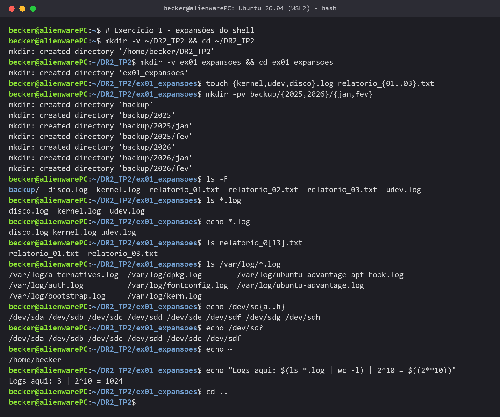

### Resposta

Um único `touch {kernel,udev,disco}.log relatorio_{01..03}.txt` criou seis arquivos, e
`mkdir -pv backup/{2025,2026}/{jan,fev}` criou as quatro combinações de ano e mês de uma vez. Para
listar, usei curingas: `ls *.log` no diretório do exercício e `ls /var/log/*.log` nos logs do
sistema. O `echo *.log` imprimiu a mesma lista, o que prova que quem expande é o shell.

O par `echo /dev/sd{a..h}` e `echo /dev/sd?` mostra a diferença que guia a escolha certa. As chaves
geraram `sdg` e `sdh`, que não existem; o curinga devolveu só os seis discos presentes. Por isso
uso **chaves para criar** e **curingas para listar**.

## Exercício 2: Pipelines e redirecionamento básico

### Enunciado

> 1. Liste os arquivos do diretório /etc
> 2. Utilize um pipeline para paginar a saída
> 3. Redirecione o resultado para um arquivo chamado pipeline.txt
> 4. Verifique o conteúdo utilizando less

### Teoria

Todo processo tem três fluxos padrão: entrada (0), saída (1) e erro (2). O pipe `|` liga a saída
de um comando à entrada do seguinte, o `>` grava a saída num arquivo e o `<` lê a entrada de um
arquivo.

### Comandos e execução

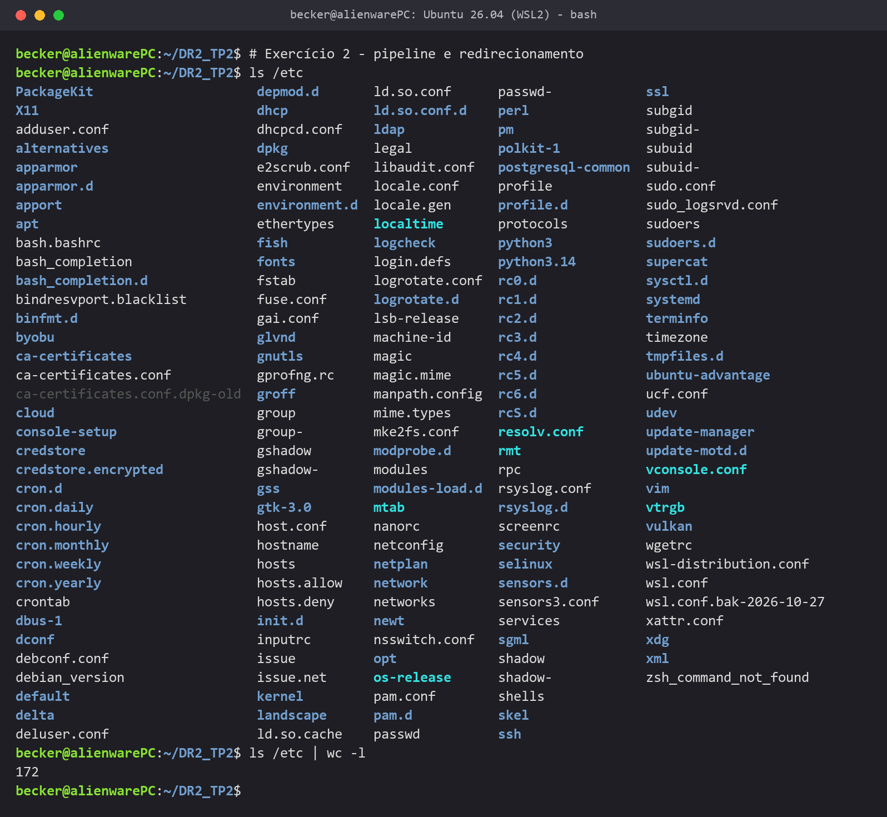

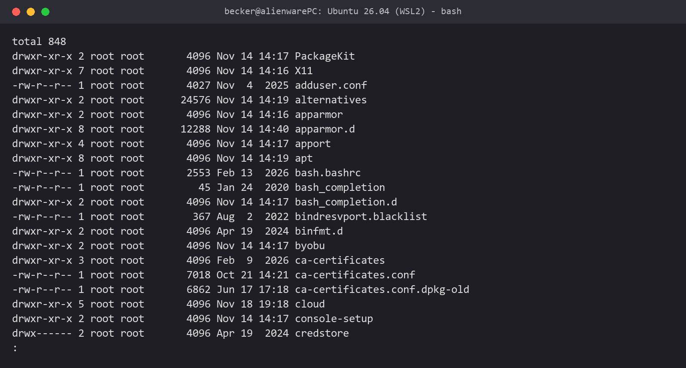

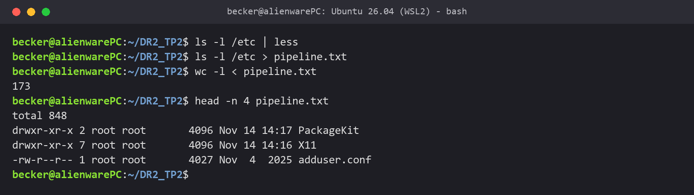

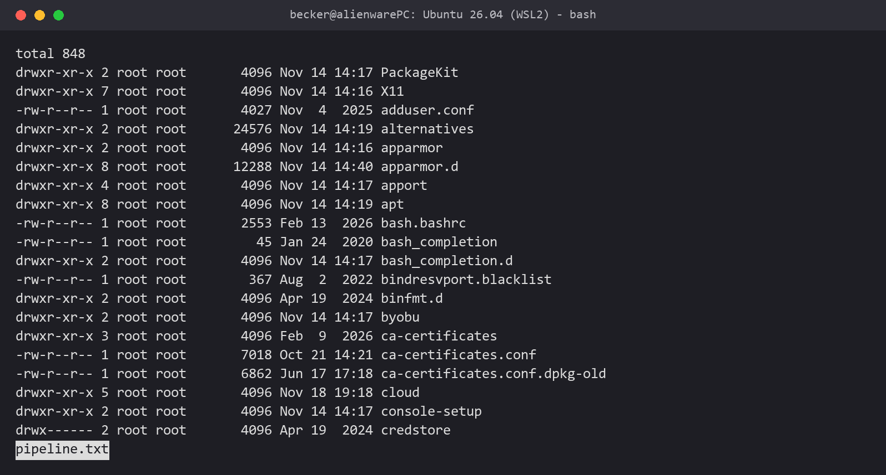

### Resposta

O `/etc` tem 172 entradas, demais para uma tela. No `ls -l /etc | less`, a saída do `ls` virou a
entrada do `less`, que a paginou. Com `>` gravei a mesma listagem em `pipeline.txt` (173 linhas:
as 172 entradas e a linha `total`). Contei as linhas com `wc -l < pipeline.txt`, que usa o
redirecionamento de **entrada**: o `wc` lê o arquivo pela entrada padrão. Por fim, abri o arquivo no
`less`. Usei o `ls -l` porque a listagem detalhada já mostra tipo e permissões, a mesma leitura do
exercício seguinte.

## Exercício 3: Pipelines para inspeção de dispositivos

### Enunciado

> 1. Liste todos os arquivos presentes no diretório /dev
> 2. Utilize um pipeline para filtrar apenas dispositivos do tipo bloco
> 3. Redirecione o resultado para um arquivo chamado dispositivos_bloco.txt
> 4. Verifique o conteúdo do arquivo utilizando less

### Teoria

O `/dev` é um `devtmpfs`: o kernel cria ali um arquivo especial para cada dispositivo. No `ls -l`, o
primeiro caractere indica o tipo: `b` (bloco: acesso em blocos, com cache, como discos), `c`
(caractere: fluxo de bytes, como terminais), `d` (diretório) e `l` (link). No lugar do tamanho
aparecem dois números, o *major* (qual driver) e o *minor* (qual unidade daquele driver).

### Comandos e execução

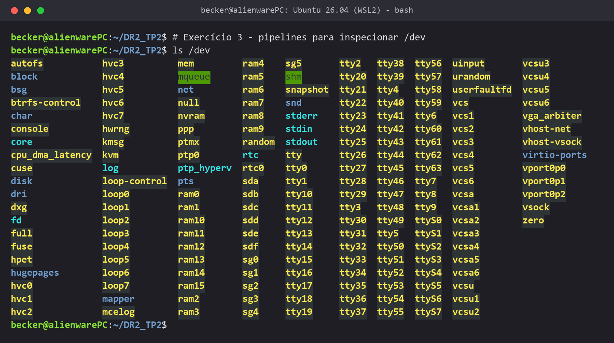

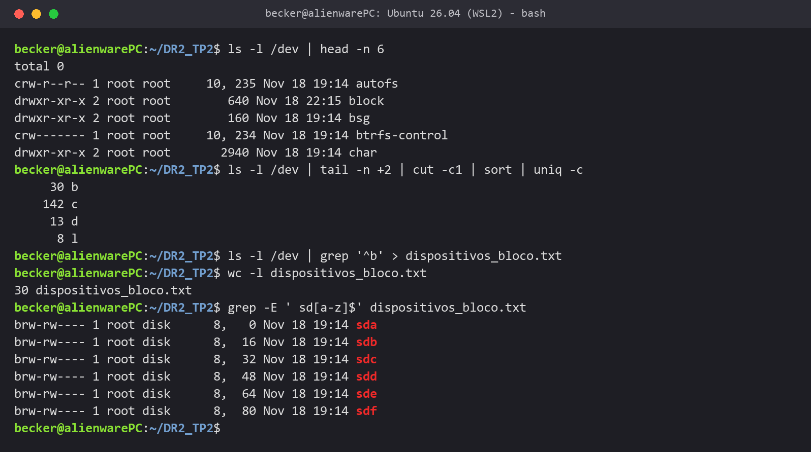

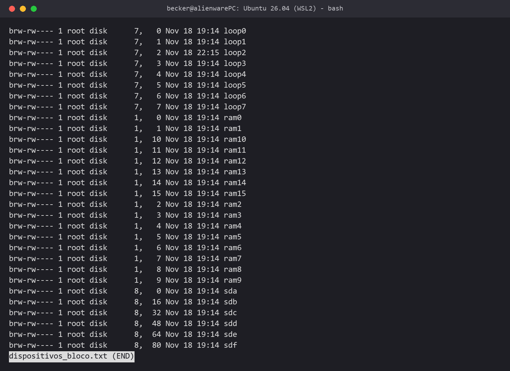

### Resposta

O filtro usa a âncora `^b` do `grep`: só passam as linhas cujo **primeiro** caractere é `b`. Um
`grep b` simples pegaria qualquer linha com a letra b no nome. Antes de filtrar, contei os tipos com
`ls -l /dev | tail -n +2 | cut -c1 | sort | uniq -c`: 30 de bloco, 142 de caractere, 13 diretórios e
8 links. O `tail -n +2` descarta a linha `total`.

Os 30 dispositivos de bloco são `loop0`–`loop7` (major 7), `ram0`–`ram15` (major 1) e os discos
`sda`–`sdf` (major 8). Todos pertencem ao grupo `disk`, com permissão `rw-rw----`: um usuário comum
não lê o disco cru.

## Exercício 4: Redirecionamento e abstração de dispositivos

### Enunciado

> 1. Execute um comando simples que gere saída textual
> 2. Redirecione essa saída para o dispositivo especial /dev/null
> 3. Execute novamente o comando sem redirecionamento
> 4. Registre em redirecionamento.txt os comandos utilizados e a diferença observada

### Teoria

O `/dev/null` é um dispositivo de caractere (major 1, minor 3, driver `mem`) que aceita qualquer
escrita e descarta os dados; a leitura devolve fim de arquivo. Como é um arquivo, o shell o usa no
redirecionamento como qualquer outro.

### Comandos e execução

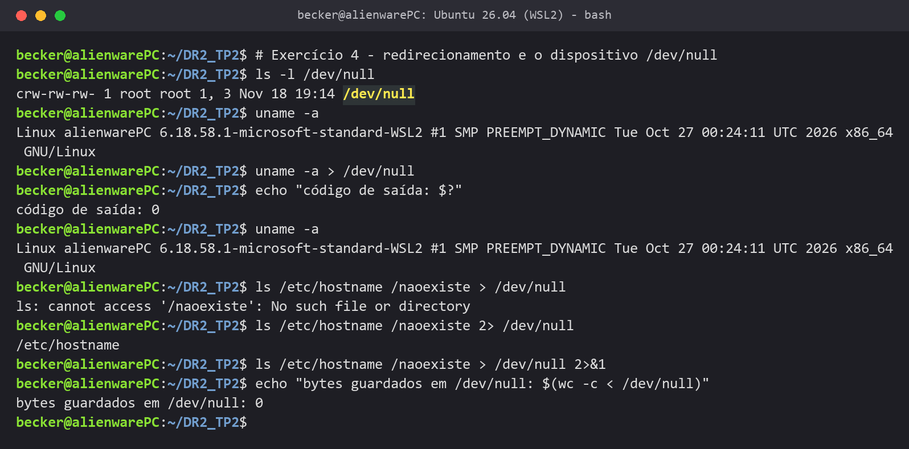

### Resposta

O `uname -a` imprimiu a identificação do kernel. Com `> /dev/null`, nada apareceu, mas o `$?` igual a
**0** mostra que o comando rodou com sucesso: a saída foi gravada no dispositivo e descartada. Sem o
redirecionamento, a linha voltou. O `wc -c < /dev/null` leu **0 bytes**, confirmando que nada fica
guardado.

Também testei os dois fluxos separadamente. O `>` desvia só a saída padrão, e o erro do arquivo
inexistente continuou na tela. O `2> /dev/null` descartou só o erro, e o `> /dev/null 2>&1`
descartou os dois. É o padrão que uso em scripts para silenciar um comando e conferir só o código de
saída.

## Exercício 5: Uso correto de aspas no shell

### Enunciado

> 1. Utilize echo com aspas simples e duplas para imprimir textos diferentes
> 2. Demonstre um caso em que o comportamento muda
> 3. Registre comandos e resultados em aspas.txt

### Teoria

O shell divide a linha em palavras nos espaços e depois expande variáveis, comandos e curingas. As
aspas controlam esse processo. As **simples** desligam tudo e o texto chega literal. As **duplas**
mantêm o texto como uma só palavra e impedem os curingas, mas deixam expandir `$VAR`, `$( )` e
`$(( ))`.

### Comandos e execução

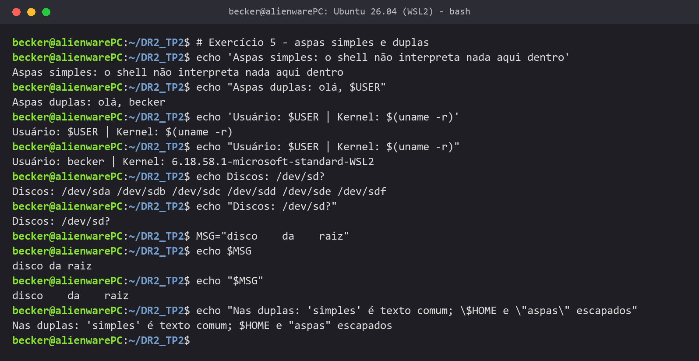

### Resposta

O caso em que o comportamento muda é o mesmo texto, `Usuário: $USER | Kernel: $(uname -r)`. Com aspas
duplas, saíram `becker` e a versão do kernel; com aspas simples, saíram os símbolos crus.

Mostrei mais duas diferenças com consequência prática. O curinga `/dev/sd?` virou a lista de discos
sem aspas, mas ficou literal entre aspas duplas. A variável `MSG="disco    da    raiz"`, sem aspas,
foi dividida em palavras e perdeu os espaços repetidos; com `"$MSG"`, eles foram preservados. Por
isso, nos pipelines do Ex. 12, a variável do disco aparece sempre como `"$DISCO"`. Dentro das
duplas, a aspa simples é um caractere comum, e `\$` e `\"` imprimem o próprio caractere.

## Exercício 6: Exploração do sysfs

### Enunciado

> 1. Liste os dispositivos de bloco disponíveis em /sys/block
> 2. Escolha um dispositivo listado
> 3. Leia ao menos dois atributos desse dispositivo no sysfs
> 4. Registre comandos e saídas em sysfs.txt

### Teoria

O sysfs (`/sys`) é um sistema de arquivos virtual que mostra o modelo de dispositivos do kernel.
Cada diretório é um objeto (dispositivo, driver, barramento) e cada arquivo é um atributo com um
único valor em texto, gerado na hora da leitura. O `/sys/block` tem um link para cada dispositivo de
bloco.

### Comandos e execução

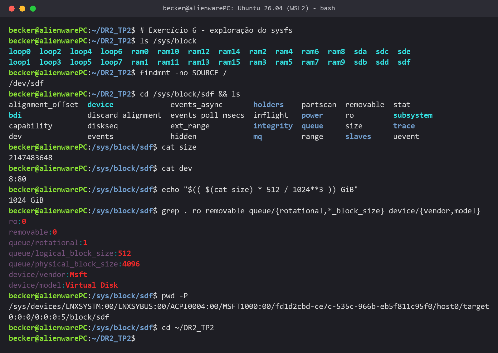

### Resposta

O `/sys/block` lista os mesmos 30 dispositivos de bloco do Ex. 3. Escolhi o `sdf` porque o
`findmnt -no SOURCE /` mostrou que ele guarda a raiz. Li os atributos com `cat` e, para ler vários de
uma vez, com `grep . arquivos`, que imprime `arquivo:valor`:

- `size` = 2147483648 setores de 512 bytes = **1024 GiB**;
- `dev` = **8:80** (major 8, driver `sd`, e minor 80);
- `ro` = 0 e `removable` = 0: gravável e fixo;
- `logical_block_size` = 512 e `physical_block_size` = 4096 bytes;
- `device/vendor` = **Msft** e `device/model` = **Virtual Disk**.

O `rotational` = 1 pede interpretação crítica. O disco se declara rotacional, mas o `.vhdx` está num
SSD NVMe do Windows: o atributo descreve o disco virtual que o Hyper-V apresenta, não a mídia
física. O `pwd -P` mostrou o caminho real do link: o disco fica sob o barramento VMBus, depois o host
SCSI (`host0`), o alvo e a LUN (`0:0:0:5`). É a hierarquia que o kernel percorre até o dispositivo de
bloco.

## Exercício 7: Metadados de dispositivos com udev

### Enunciado

> 1. Identifique um dispositivo de armazenamento presente em /dev
> 2. Utilize udevadm info para inspecionar seus metadados
> 3. Redirecione a saída para udev_info.txt
> 4. Destaque informações relacionadas ao tipo de dispositivo e fabricante

### Teoria

Quando o kernel detecta um dispositivo, ele emite um evento (*uevent*). O `systemd-udevd` recebe o
evento, aplica as regras de `/usr/lib/udev/rules.d`, consulta o hardware e registra propriedades
(`ID_*`). Também cria os links persistentes em `/dev/disk/by-id`, `by-uuid` e `by-path`. O
`udevadm info` mostra esse banco de dados.

### Comandos e execução

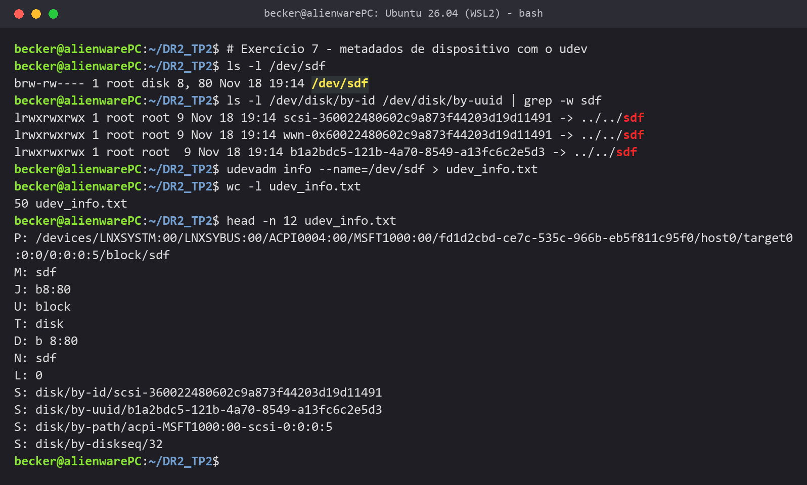

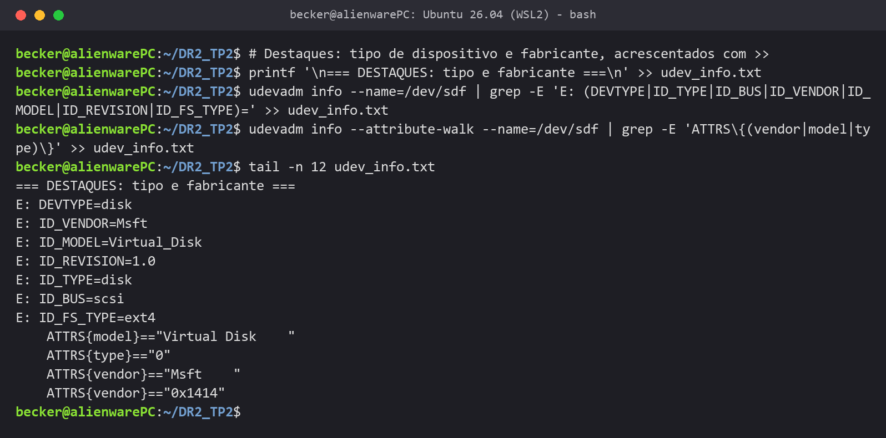

### Resposta

Redirecionei o `udevadm info --name=/dev/sdf` para `udev_info.txt` (50 linhas). Para destacar o que
o exercício pede, acrescentei ao fim do mesmo arquivo, com `>>`, as linhas filtradas por `grep -E`:

- **Tipo:** `DEVTYPE=disk` e `ID_TYPE=disk` (disco inteiro, não partição), `ID_BUS=scsi` e o
  atributo SCSI `type` = 0 (*direct-access*, um disco).
- **Fabricante:** `ID_VENDOR=Msft`, `ID_MODEL=Virtual_Disk` e `ID_REVISION=1.0`. Subindo na árvore com
  `--attribute-walk`, o barramento pai tem `vendor` = **0x1414**, o código PCI da Microsoft.
- **Filesystem:** `ID_FS_TYPE=ext4`, que o udev descobre lendo a assinatura do disco.

O udev também criou os links `by-id` (pelo identificador SCSI/WWN) e `by-uuid` (pelo UUID do ext4),
estáveis entre reinicializações, ao contrário da letra `sdf`.

## Exercício 8: Mensagens do kernel e hardware

### Enunciado

> 1. Utilize journalctl -k para visualizar mensagens do kernel
> 2. Filtre mensagens relacionadas a dispositivos de armazenamento
> 3. Salve o resultado em kernel_devices.txt

### Teoria

O kernel escreve as mensagens no *ring buffer* (o mesmo que o `dmesg` lê), e o `systemd-journald` as
guarda no journal. O `journalctl -k` mostra só as mensagens do kernel, e o `-b`, só as do boot atual.
Ler o journal exige o grupo `adm` ou `systemd-journal`; o meu usuário está no `adm`.

### Comandos e execução

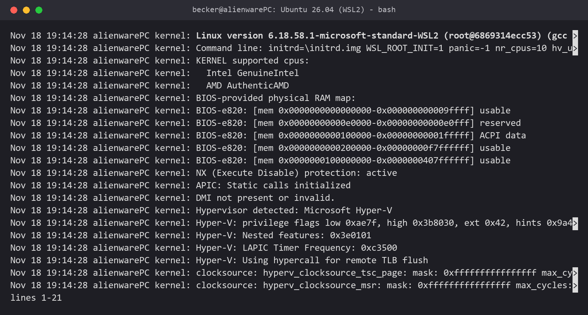

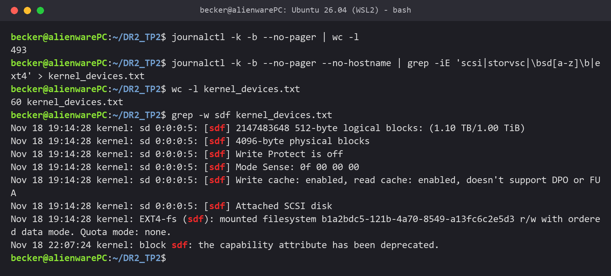

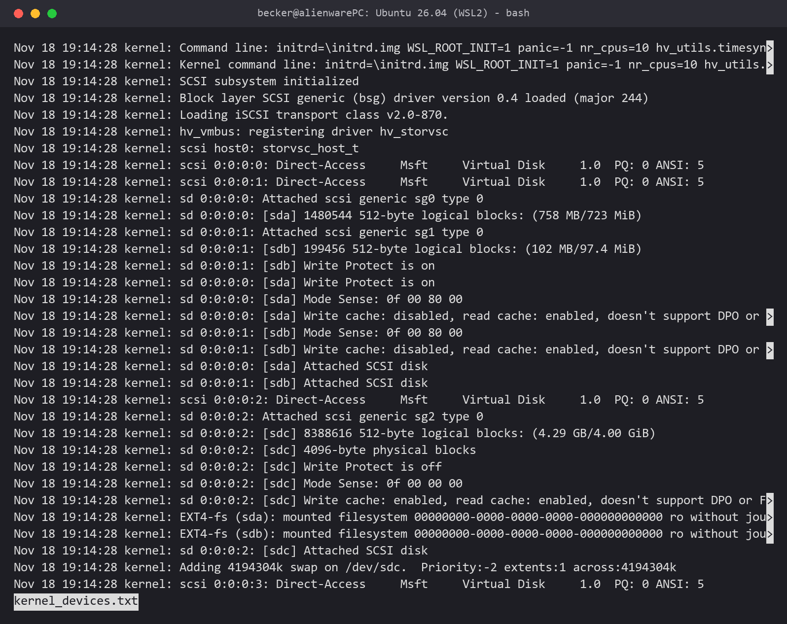

### Resposta

Das 493 mensagens do kernel neste boot, o filtro `grep -iE 'scsi|storvsc|\bsd[a-z]\b|ext4'` separou
60 sobre armazenamento. Escolhi os termos pela cadeia que o kernel percorre:

1. o subsistema SCSI é iniciado;
2. o driver `hv_storvsc` se registra no barramento VMBus do Hyper-V;
3. cada disco virtual é detectado (`Direct-Access Msft Virtual Disk`);
4. o driver `sd` o anexa como `sda`…`sdf`, com tamanho, blocos e cache;
5. o `sdc` é ativado como swap e os ext4 são montados.

O `\b` (borda de palavra) faz `sd[a-z]` casar só com nomes inteiros, como `sda` ou `[sdf]`, e não
com trechos de outras palavras. O `-i` pega `EXT4` e `SCSI` em maiúsculas.

A última linha do `sdf` merece nota. Às 22:07, o kernel avisou que o atributo `capability` está
obsoleto. Ela não vem do boot. Foi gerada durante a investigação, quando um dos comandos que
percorrem o sysfs leu esse atributo do disco; o aviso sai uma vez por boot, na primeira leitura. É
um exemplo de como o kernel registra também o uso que o espaço de usuário faz das suas interfaces.

## Exercício 9: Dispositivos e drivers ativos

### Enunciado

> 1. Liste os drivers registrados no sistema utilizando /proc/devices
> 2. Redirecione a saída para drivers.txt
> 3. Identifique ao menos um driver de bloco e um de caractere

### Teoria

O `/proc/devices` lista os números *major* registrados no kernel, separados em dispositivos de
caractere e de bloco. É o elo entre o arquivo em `/dev` e o driver: ao abrir `/dev/sdf` (major 8),
o kernel entrega a operação ao driver registrado com o número 8.

### Comandos e execução

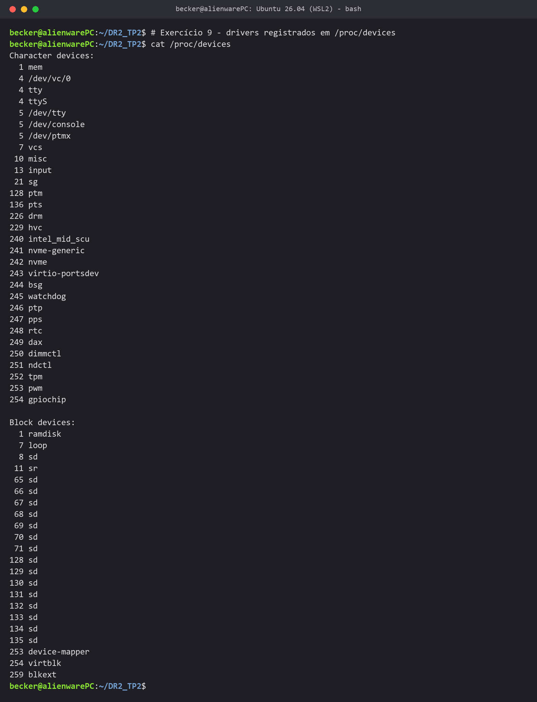

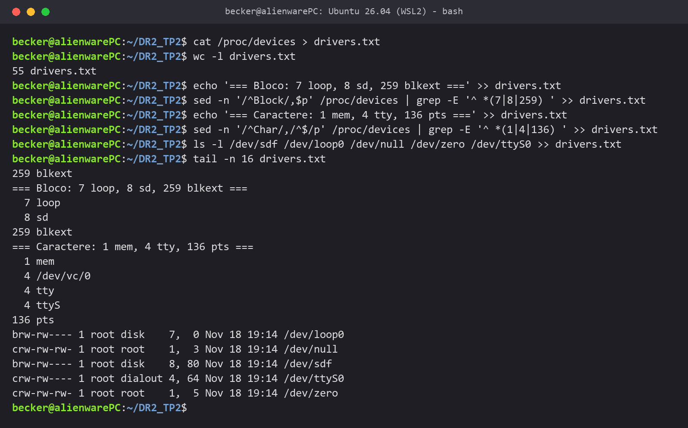

### Resposta

Redirecionei o `/proc/devices` para `drivers.txt` e acrescentei, com `>>`, a identificação, isolada
por `sed -n '/^Block/,$p'` (só a seção de bloco) e `grep`:

- **Bloco:** `8 sd`, o driver de discos SCSI que atende o `/dev/sdf` (8, 80). Também `7 loop`, dos
  *loop devices*, e `259 blkext`, que numera as partições do disco de laboratório no Ex. 10.
- **Caractere:** `1 mem`, que implementa `/dev/null` (1, 3) e `/dev/zero` (1, 5). Também `4 tty`,
  dos terminais seriais (`/dev/ttyS0` é 4, 64), e `136 pts`, os pseudoterminais onde o bash do tmux
  roda.

A conferência com `ls -l` fecha o raciocínio: o major de cada arquivo em `/dev` bate com a linha do
driver em `/proc/devices`. O driver `sd` aparece 16 vezes porque reservou vários números major
(8, 65–71 e 128–135) para comportar centenas de discos.

## Exercício 10: Identificação de dispositivos de armazenamento

### Enunciado

> 1. Utilize lsblk para listar discos e partições
> 2. Execute o comando de forma que a hierarquia fique clara
> 3. Salve a saída em armazenamento.txt

### Teoria

O `lsblk` lê o sysfs e monta a árvore dos dispositivos de bloco: discos na raiz e, abaixo, as
partições (`part`) e o que for construído sobre elas (LVM, criptografia), ligados por `├─` e `└─`.
Com `-o`, escolho as colunas.

### Comandos e execução

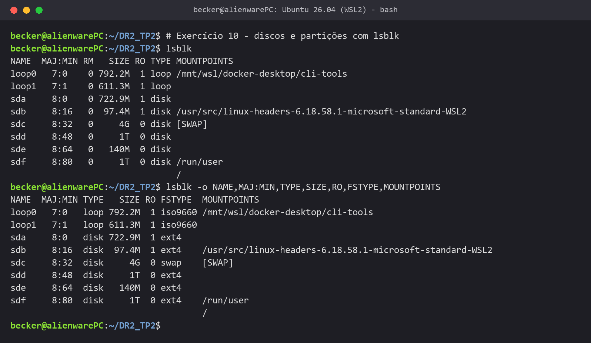

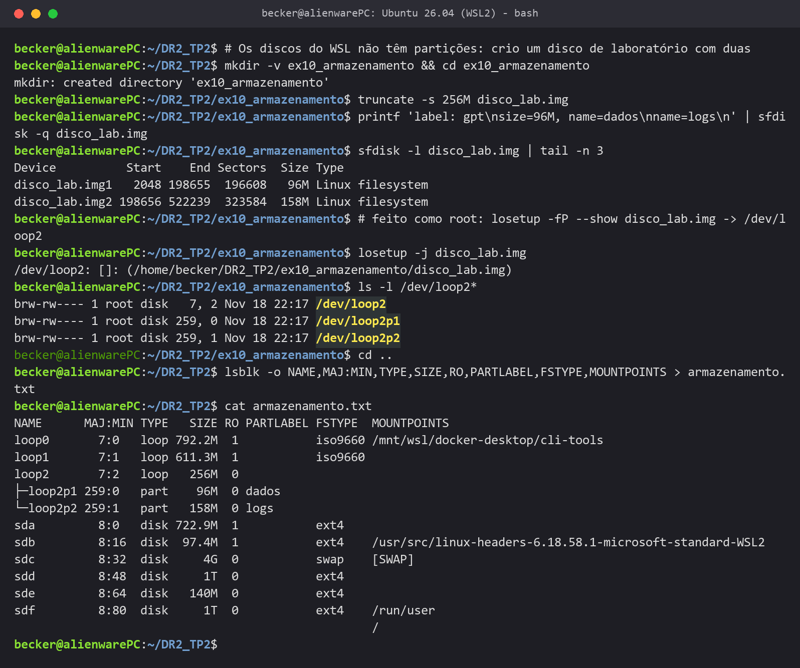

### Resposta

O primeiro `lsblk` mostrou os seis discos do WSL, todos `disk` **sem partições**. O WSL formata cada
`.vhdx` inteiro, sem tabela de partições. Com só esses discos, a árvore não teria nenhum nível, e
a hierarquia que o exercício pede não ficaria clara.

Para mostrá-la sem tocar em nenhum disco real, criei um disco de laboratório:

1. `truncate -s 256M disco_lab.img` criou um arquivo esparso;
2. o `sfdisk` gravou nele uma tabela GPT com as partições `dados` (96 MiB) e `logs` (158 MiB);
3. o `losetup -fP` o associou ao `/dev/loop2` e pediu ao kernel que lesse as partições.

O `ls -l /dev/loop2*` mostrou o disco (7, 2) e as partições `loop2p1` e `loop2p2` (259, 0 e 259, 1).

A saída salva em `armazenamento.txt` usa
`lsblk -o NAME,MAJ:MIN,TYPE,SIZE,RO,PARTLABEL,FSTYPE,MOUNTPOINTS`. Nela, a árvore liga `loop2` às duas
partições, e as colunas deixam a hierarquia explícita:

- `TYPE` distingue `loop`, `disk` e `part`;
- `MAJ:MIN` liga cada item ao driver;
- `RO` mostra que `sda`, `sdb` e os ISOs do Docker são somente leitura;
- `MOUNTPOINTS` mostra que o `sdf` está montado em `/`;
- `PARTLABEL` mostra o nome das partições GPT.

## Exercício 11: Filesystems montados

### Enunciado

> 1. Utilize o comando mount para listar filesystems montados
> 2. Redirecione a saída para filesystems.txt
> 3. Utilize df para complementar a análise de uso de espaço

### Teoria

Montar é ligar um filesystem a um diretório da árvore única que começa em `/`. O `mount` sem
argumentos lista as montagens ativas (de `/proc/self/mountinfo`): origem, ponto, tipo e opções. O
`df` complementa com o uso de espaço (`-h` em unidades legíveis, `-T` com o tipo) e de inodes (`-i`).

### Comandos e execução

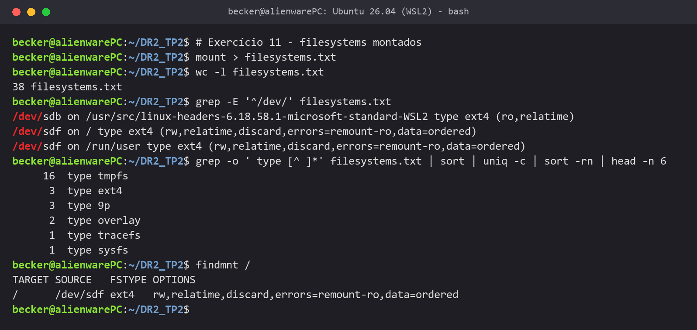

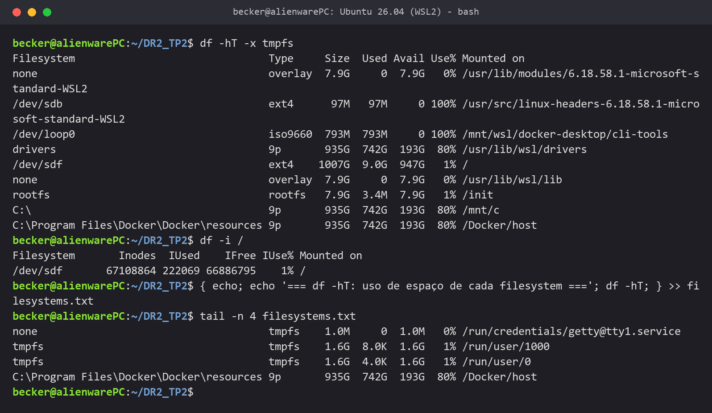

### Resposta

O `mount` listou 38 montagens, mas só três vêm de dispositivos de bloco (`grep -E '^/dev/'`):

- o `sdf` em `/`, com `rw` e `errors=remount-ro`, que volta para somente leitura se o ext4 detectar
  erro;
- o mesmo `sdf` em `/run/user`;
- o `sdb` em `/usr/src/linux-headers-…`, somente leitura.

A contagem por tipo mostra que a maioria é virtual: 16 `tmpfs` (em RAM) e os pseudo-filesystems
`proc`, `sysfs`, `devtmpfs` e `cgroup2`. Os três `9p` são pastas do Windows (o drive `C:`, os
drivers e os recursos do Docker), acessadas pelo protocolo 9P entre a VM e o Windows.

O `df` complementou com o uso de espaço. Usei o `-x tmpfs` para ver só o que ocupa armazenamento. A
raiz tem **1007G**, com 9,0G usados (1%), e o `C:` tem 935G, 80% ocupados. O `df -i /` mostra 1%
dos 67 milhões de inodes em uso. Acrescentei o `df -hT` completo ao fim de `filesystems.txt`, para o
arquivo reunir as duas visões: onde cada filesystem está montado e quanto espaço ele usa.

## Exercício 12: Análise integrada de um dispositivo

### Enunciado

> 1. Identifique um dispositivo de armazenamento disponível no sistema
> 2. Utilize pipelines para isolar informações referentes apenas a esse dispositivo
> 3. Analise o dispositivo a partir das seguintes perspectivas: a) Representação no diretório /dev; b) Reconhecimento pelo kernel e suas partições; c) Organização na hierarquia de block devices
> 4. Utilize redirecionamento de saída para registrar separadamente cada etapa
> 5. Utilize ao menos um comando auxiliar para investigar um dos comandos utilizados
> 6. Consolide todas as informações em analise_final.txt, organizando o conteúdo por seções, indicando: comandos executados; finalidade de cada comando; principais informações obtidas

### Teoria

Cada interface do Linux mostra uma face do mesmo dispositivo:

- o `/dev` e o udev, o **arquivo** pelo qual os programas o acessam;
- o `/proc` e o journal, o que o **kernel** reconheceu;
- o sysfs e o `lsblk`, onde ele está na **hierarquia**.

Uma análise profissional cruza as fontes, e cada passo fica registrado para poder ser conferido.

### Comandos e execução

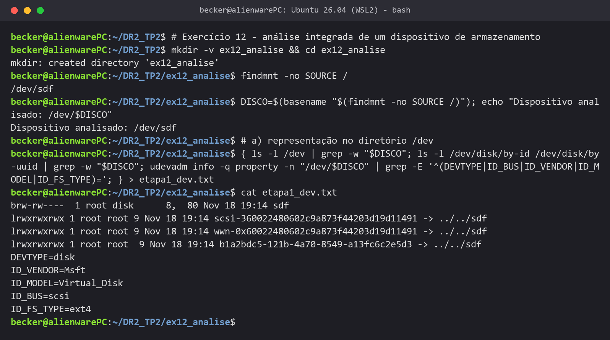

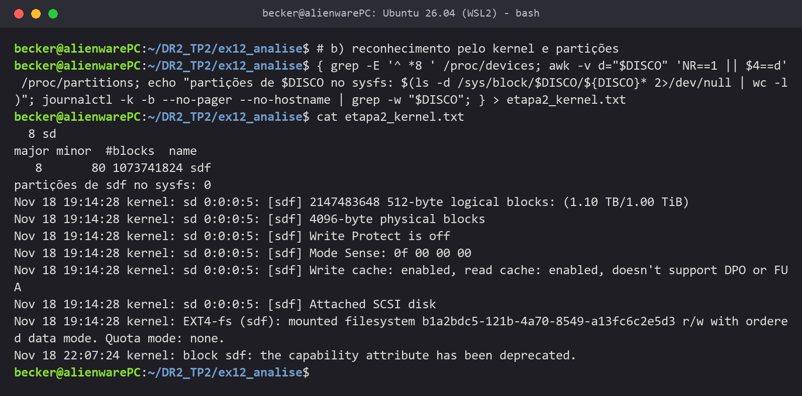

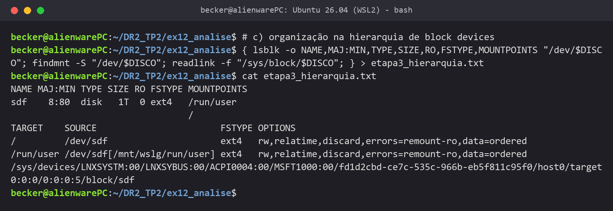

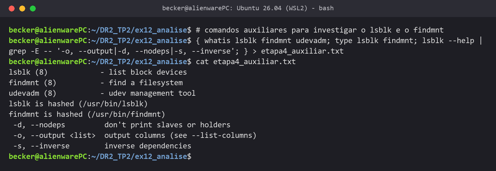

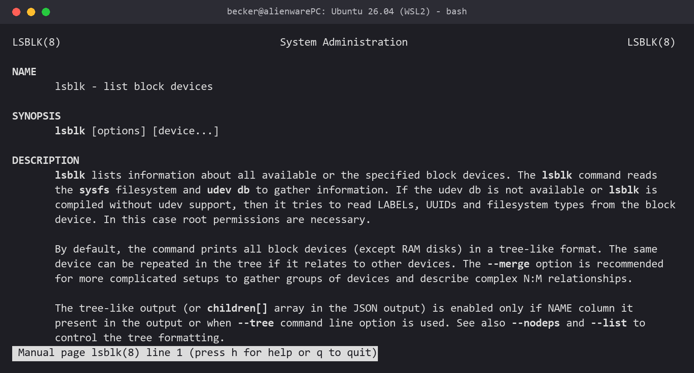

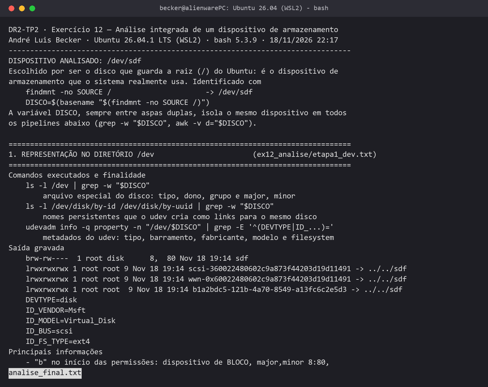

### Resposta

Identifiquei o disco com `findmnt -no SOURCE /` e guardei o nome numa variável,
`DISCO=$(basename "$(findmnt -no SOURCE /)")`. Todos os pipelines seguintes usam `"$DISCO"`, de
modo que a mesma análise vale para qualquer máquina. O `grep -w` (palavra inteira) evita que `sdf`
case com `sdf1` ou outro nome que o contenha. Cada etapa foi um bloco `{ …; } > etapaN.txt`, que
grava num arquivo próprio a saída de vários comandos:

- **a) Representação em /dev:** o `sdf` é um dispositivo de **bloco** (`b`), com major,minor 8,80 e grupo `disk`.
  O udev mantém dois nomes estáveis para ele, por identificador SCSI e por UUID, e o classifica como
  `disk` no barramento `scsi`, do fabricante `Msft`, com `ext4`.
- **b) Kernel e partições:** o major 8 é do driver `sd`. Em `/proc/partitions`, o disco aparece com
  1073741824 blocos de 1 KiB (1 TiB) e **nenhuma partição**, o que o sysfs confirma (0
  subdiretórios `sdf*`). O journal mostra a detecção no boot e a montagem do ext4.
- **c) Hierarquia:** no `lsblk`, é um nó `disk` de 1 TB sem filhos. Pelo `findmnt -S`, o mesmo
  filesystem está montado em `/` e em `/run/user`, este um *bind mount* de um subdiretório feito
  pelo WSLg. No sysfs, ele fica sob o VMBus, depois o host SCSI, o alvo e a LUN.

Como comando auxiliar, usei o `whatis` para a descrição do `lsblk`, do `findmnt` e do `udevadm`. O
`type` mostrou onde estão (`/usr/bin`; "hashed" significa que o bash já guardou o caminho). O
`lsblk --help` e o `man lsblk` mostraram as opções `-o`, `-d` e `-s`. Por fim, o `analise_final.txt`
reúne as quatro etapas em seções com os comandos executados, a finalidade de cada um, a saída
gravada e as principais informações, e termina com a conclusão.

## Atendimento à rubrica

| Critério | Onde está |
|---|---|
| Utiliza shell expansions de forma correta e eficiente | Ex. 1 (chaves × curingas), e as expansões nos Ex. 6 (`{ }` e `*` no `grep .`), 10 e 12 (`$( )`) |
| Cria pipelines e redireciona entrada e saída | Ex. 2 (`\|`, `>`, `<`), 3, 4 (`2>`, `2>&1`), 7 e 9 (`>>`), 8, 11 e 12 (`{ …; } >`) |
| Utiliza corretamente aspas simples e duplas | Ex. 5, e o `"$DISCO"` do Ex. 12 |
| Investiga dispositivos e drivers expostos pelo kernel | Ex. 3 (`/dev`), 6 (sysfs), 9 (`/proc/devices`) e 12 |
| Interpreta sysfs, udev e logs do kernel | Ex. 6, 7 e 8, com a leitura crítica do `rotational` e da linha do `capability` |
| Identifica e analisa armazenamento e filesystems | Ex. 10 (disco de laboratório particionado) e Ex. 11 (`mount`, `findmnt`, `df`) |
| Integra múltiplos comandos num fluxo coerente | Ex. 12: um disco, três perspectivas, um arquivo por etapa |
| Organiza e documenta tecnicamente o processo | `~/DR2_TP2` com um `.txt` por exercício, `analise_final.txt` por seções e a Figura 29 |
| Justifica tecnicamente as decisões | Apresentação (escolha do disco, disco de laboratório) e resposta de cada exercício |

## Anexo: arquivos de evidência

Conteúdo integral dos arquivos gravados em `~/DR2_TP2`, cuja organização a Figura 29 mostra. A
imagem `disco_lab.img` (256 MiB) não é reproduzida.

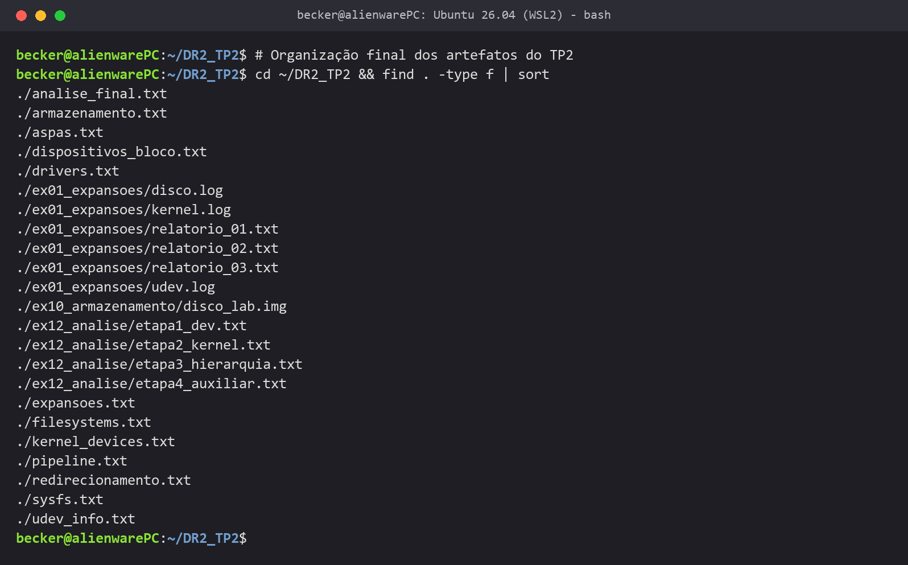

<!-- arquivo: expansoes.txt -->
<!-- arquivo: pipeline.txt -->
<!-- arquivo: dispositivos_bloco.txt -->
<!-- arquivo: redirecionamento.txt -->
<!-- arquivo: aspas.txt -->
<!-- arquivo: sysfs.txt -->
<!-- arquivo: udev_info.txt -->
<!-- arquivo: kernel_devices.txt -->
<!-- arquivo: drivers.txt -->
<!-- arquivo: armazenamento.txt -->
<!-- arquivo: filesystems.txt -->
<!-- arquivo: ex12_analise/etapa1_dev.txt -->
<!-- arquivo: ex12_analise/etapa2_kernel.txt -->
<!-- arquivo: ex12_analise/etapa3_hierarquia.txt -->
<!-- arquivo: ex12_analise/etapa4_auxiliar.txt -->
<!-- arquivo: analise_final.txt -->

<!-- so-github -->
| Arquivo | Exercício |
|---|---|
| [expansoes.txt](../evidencias/DR2_TP2/expansoes.txt) | 1 |
| [pipeline.txt](../evidencias/DR2_TP2/pipeline.txt) | 2 |
| [dispositivos_bloco.txt](../evidencias/DR2_TP2/dispositivos_bloco.txt) | 3 |
| [redirecionamento.txt](../evidencias/DR2_TP2/redirecionamento.txt) | 4 |
| [aspas.txt](../evidencias/DR2_TP2/aspas.txt) | 5 |
| [sysfs.txt](../evidencias/DR2_TP2/sysfs.txt) | 6 |
| [udev_info.txt](../evidencias/DR2_TP2/udev_info.txt) | 7 |
| [kernel_devices.txt](../evidencias/DR2_TP2/kernel_devices.txt) | 8 |
| [drivers.txt](../evidencias/DR2_TP2/drivers.txt) | 9 |
| [armazenamento.txt](../evidencias/DR2_TP2/armazenamento.txt) | 10 |
| [filesystems.txt](../evidencias/DR2_TP2/filesystems.txt) | 11 |
| [ex12_analise/](../evidencias/DR2_TP2/ex12_analise) (etapas 1 a 4) | 12 |
| [analise_final.txt](../evidencias/DR2_TP2/analise_final.txt) | 12 |
<!-- /so-github -->

## Referências

- SHOTTS, W. *The Linux Command Line*. 2. ed. San Francisco: No Starch Press, 2019. Caps. 6, 7 e 15.
- TANENBAUM, A. S.; BOS, H. *Sistemas Operacionais Modernos*. 4. ed. São Paulo: Pearson, 2016. Cap. 5 (Entrada/Saída).
- KERNEL.ORG. *sysfs: the filesystem for exporting kernel objects*; *Linux allocated devices*. Documentação do kernel Linux.
- Páginas de manual do Ubuntu 26.04: `bash(1)`, `sysfs(5)`, `udevadm(8)`, `journalctl(1)`, `proc(5)`, `lsblk(8)`, `losetup(8)`, `sfdisk(8)`, `mount(8)`, `findmnt(8)` e `df(1)`.
- MICROSOFT. *Documentação do WSL: discos virtuais e sistema de arquivos do WSL 2*.
